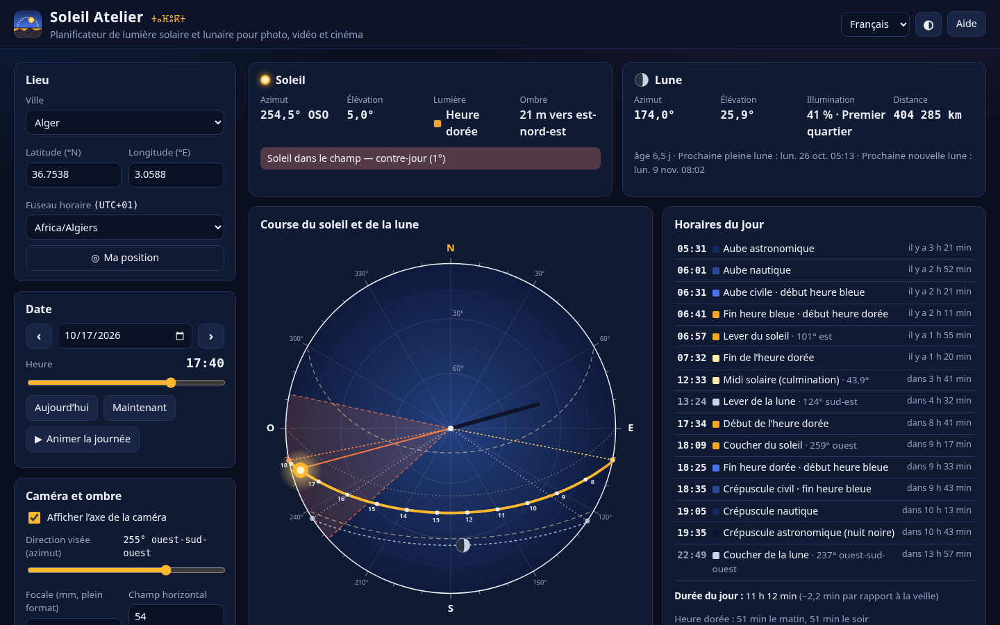
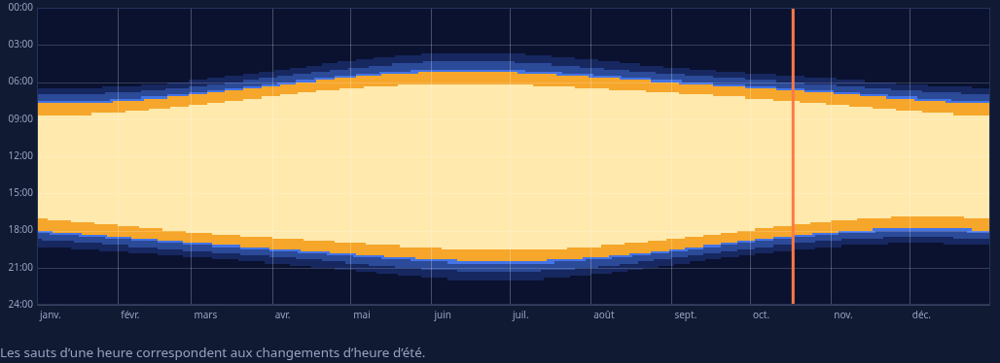
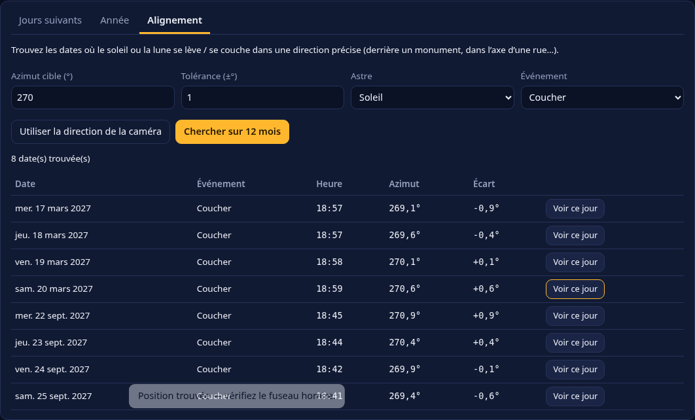
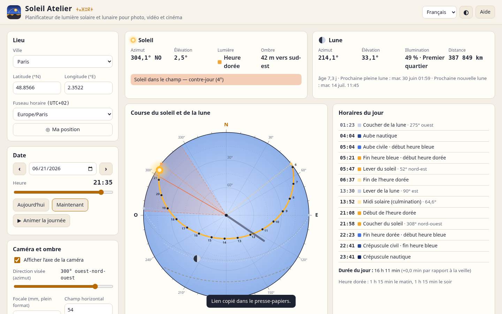
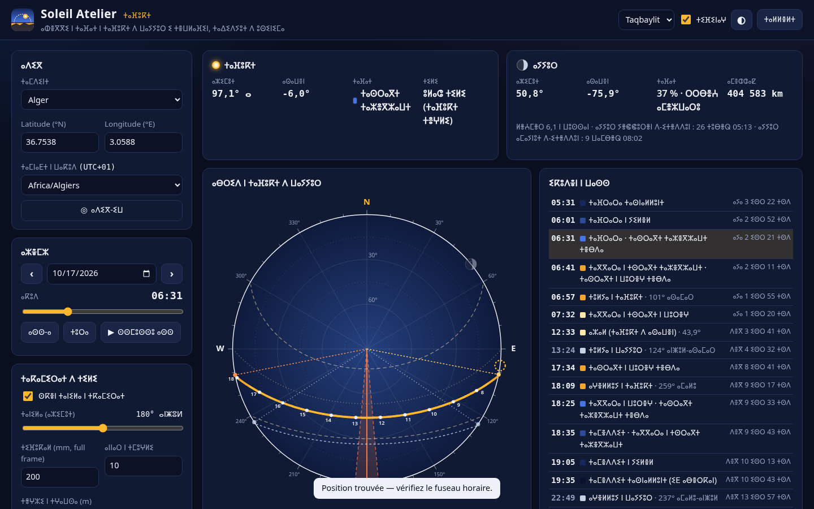
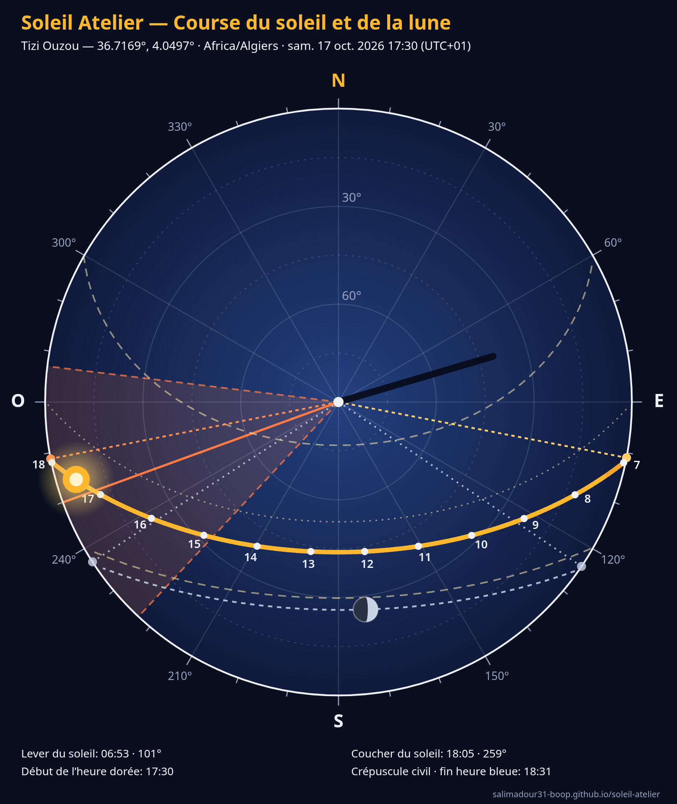
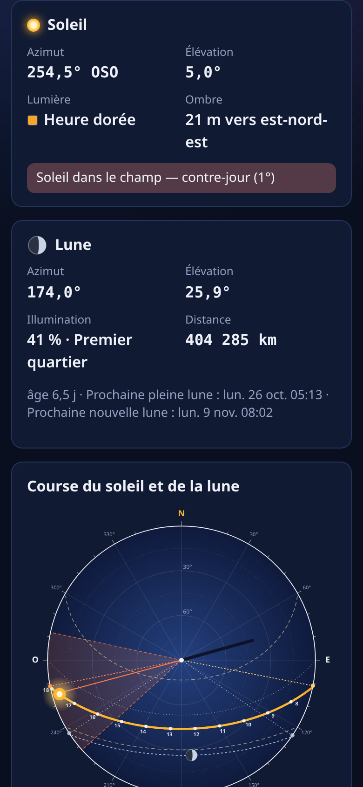

# Soleil Atelier 

**Planificateur gratuit de lumière solaire et lunaire** pour photographes, vidéastes et cinéastes, dans le navigateur : **heure dorée, heure bleue**, aubes et crépuscules, **course du soleil et de la lune** sur une carte du ciel, **champ de la caméra** (le soleil est-il dans le cadre ?), **longueur et direction des ombres**, phases de la lune, **graphique de lumière sur toute l’année**, **recherche d’alignements** (soleil ou lune qui se lève / se couche dans l’axe d’une rue ou derrière un monument), exports **PNG, CSV, calendrier .ics et JSON**.

👉 **Démo : https://salimadour31-boop.github.io/soleil-atelier/**

Interface en **français**, **anglais** et **taqbaylit** (avec affichage optionnel en **tifinagh** ⵜⵉⴼⵉⵏⴰⵖ). Aucun compte, aucune clé d’API, aucune carte en ligne, aucune bibliothèque externe : tous les calculs astronomiques sont faits localement et l’outil fonctionne hors ligne une fois chargé.



## Fonctionnalités

### Lieu et moment
- **47 villes prêtes à l’emploi** (Algérie en tête : Alger, Tizi Ouzou, Béjaïa, Bouira, Oran, Constantine, Ghardaïa, Djanet, Tamanrasset… puis Maghreb, Europe, Amériques, Asie/Océanie), **coordonnées libres** et **tous les fuseaux horaires IANA** (heure d’été gérée, y compris les journées de 23 h et 25 h).
- Bouton **Ma position** (géolocalisation du navigateur, facultative — la position ne quitte pas l’appareil).
- **Date** (jour précédent / suivant, aujourd’hui) et **heure** au curseur, en faisant glisser la **frise de 24 h** ou le **graphique de hauteur**, ou au clavier ; **animation** de la journée.

### Lumière du jour
- **Horaires du jour** : aube astronomique, nautique, civile, **début / fin de l’heure bleue et de l’heure dorée** (matin et soir), **lever et coucher** avec leur **azimut** et direction en clair, **midi solaire** avec la hauteur maximale, lever / coucher / culmination de la **lune** ; compte à rebours (« dans 1 h 05 ») quand la date est aujourd’hui ; cliquez une ligne pour s’y placer.
- **Durée du jour** et écart avec la veille, **durée des heures dorées** du matin et du soir.
- **Soleil de minuit et nuit polaire** détectés (essayez Tromsø en juin et en décembre).
- **Lecture en direct** : azimut, élévation apparente (réfraction comprise), phase de lumière, **ombre portée** d’un objet de hauteur réglable ; lune : azimut, élévation, illumination, phase, âge, distance, **prochaines pleine et nouvelle lunes**.

### Carte du ciel
- Vue d’en haut : horizon sur le cercle, zénith au centre, nord en haut, anneaux de hauteur et graduations d’azimut.
- **Course du jour** (en orange sous 6° : heure dorée) avec les **heures**, **courses des solstices** (juin / décembre) et de l’**équinoxe**, **directions de lever / coucher** du soleil et de la lune, **course de la lune** et son disque avec la **phase dessinée**, **ombre** d’un piquet planté au centre.
- **Champ de la caméra** : direction visée (curseur ou **clic / glisser sur le diagramme**) et **focale plein format** ↔ champ horizontal ; l’outil indique si le soleil est **dans le cadre (contre-jour)**, **de face** ou **latéral**.

### Graphiques et outils
- **Frise de lumière sur 24 h** (nuit, crépuscules, heure bleue, heure dorée, plein jour) avec la présence de la lune, et **courbe de hauteur** du soleil et de la lune avec les bandes « heure dorée » et « heure bleue ».
- **Tableau des 7, 14 ou 30 jours suivants** (aube, lever, fin de l’heure dorée, midi, début de l’heure dorée, coucher, crépuscule, durée, lune).
- **Graphique annuel** : toute l’année d’un coup d’œil (heure locale × jours), on y voit les heures dorées s’allonger en hiver et les changements d’heure.
- **Alignements** : trouvez sur 12 mois les dates où le **soleil ou la lune** se lève / se couche dans un **azimut donné** (± tolérance) — par exemple le coucher du soleil dans l’axe d’une rue, ou la pleine lune qui se lève derrière un monument. Bouton « Voir ce jour » pour ouvrir la date trouvée.

### Exports et partage
- **Diagramme PNG** (1600 × 1900, avec lieu, date, heure et horaires clés) et **graphique annuel PNG** (2000 × 1100, avec légende).
- **CSV** des jours suivants (toutes les heures, azimuts, illumination de la lune — UTF-8, compatible tableur).
- **Calendrier .ics** : les **heures dorées et bleues** des jours suivants à importer dans Google Agenda, Apple Calendrier, Outlook… (format RFC 5545, heures en UTC).
- **JSON** des réglages et des horaires (réouvrable dans l’outil) et **lien partageable** : lieu, date, heure, caméra et langue sont dans l’adresse (`#lat=36.7538&lon=3.0588&tz=Africa/Algiers&d=2026-10-17&t=17:40…`).
- Thème sombre / clair, responsive (bureau et mobile ~390 px), libellés accessibles, raccourcis clavier.

## Utilisation
1. Ouvrez la [démo](https://salimadour31-boop.github.io/soleil-atelier/) (ou `index.html` en local : aucun serveur ni installation nécessaires).
2. Choisissez une **ville** (ou vos coordonnées et le bon fuseau horaire) et une **date**.
3. Faites glisser l’**heure** : le soleil, la lune, l’ombre et la phase de lumière se mettent à jour.
4. Activez la **caméra**, cliquez sur le diagramme dans la direction de votre plan et réglez la **focale** pour savoir si le soleil sera dans le cadre.
5. Préparez le tournage : **tableau des jours suivants**, **calendrier .ics** des heures dorées, **alignements**, et **copiez le lien** pour l’équipe.

Raccourcis : `←` `→` ±10 min (`Maj` = ±1 h), `Page préc.` / `Page suiv.` jour précédent / suivant, `T` aujourd’hui, `Espace` animation.

## Définitions et précision
- **Heure dorée** : soleil entre **−4° et +6°** ; **heure bleue** : entre **−6° et −4°** ; crépuscules civil / nautique / astronomique : −6°, −12°, −18° ; lever / coucher : bord supérieur du soleil à l’horizon (−0,833°, réfraction comprise).
- Soleil : algorithmes du **NOAA / Meeus** (position ≈ 0,01°) ; lune : **théorie de Meeus tronquée** (≈ 0,1–0,2°), altitude topocentrique (parallaxe), bord supérieur et réfraction pour le lever / coucher.
- Vérifié par les tests contre une **implémentation indépendante** (paquet Python `astral`) sur 7 lieux × 5 dates : **écarts ≤ 2,5 min** pour le soleil et **≤ 3 min** pour la lune ; pleine lune du 26 octobre 2026 retrouvée à quelques minutes près.
- Horizon plat et altitude 0 m : collines et immeubles avancent le coucher réel (et retardent le lever).

## Captures
| Graphique annuel (Alger) | Alignements : coucher plein ouest |
|---|---|
|  |  |
| **Thème clair — Paris, solstice d’été, 21 h 35** | **Taqbaylit en tifinagh** |
|  |  |

| Export PNG du diagramme | Mobile (390 px) |
|---|---|
|  |  |

## Confidentialité
Tout est **calculé dans votre navigateur** : aucune requête vers un serveur, pas de cookies, pas de statistiques, pas de police ni de script chargés depuis un autre site. La position GPS (facultative) n’est utilisée que localement. Seuls la langue et le thème sont mémorisés (`localStorage`).

## Structure
```
index.html          interface
css/style.css       styles (sombre / clair, responsive)
js/astro.js         soleil et lune (positions, événements, phases, ombres, alignements), fuseaux horaires (sans DOM)
js/render.js        carte du ciel, frise de 24 h, courbe de hauteur, graphique annuel, disque de la lune
js/cities.js        villes prêtes à l’emploi (coordonnées + fuseau)
js/settings.js      réglages par défaut, validation, lien (#hash), focale ↔ champ
js/i18n.js          textes FR / EN / taqbaylit + translittération tifinagh
js/app.js           interface : contrôles, lectures, dessins, tableaux, exports
fonts/              Noto Sans Tifinagh (licence OFL, fichier inclus)
tests/              tests unitaires (Node), données de référence (astral) et test d’interface (Playwright)
```
HTML / CSS / JavaScript pur, sans dépendance ni étape de compilation.

## Tests
```bash
node tests/astro.test.js      # 22 tests : référence astral, fuseaux / heure d’été, cas polaires, ombres, phases, alignements, réglages, i18n
npm i playwright && node tests/ui.test.js   # 36 vérifications d’interface, bureau 1440 px et mobile 390 px, écrit les captures
```
`tests/make-reference.py` régénère les données de référence (`pip install astral==3.2`).

## Licence
[MIT](LICENSE) — code et textes originaux. Police Noto Sans Tifinagh sous licence SIL OFL 1.1 (fichier joint dans `fonts/`). Les textes en taqbaylit sont une première version : corrections bienvenues !
